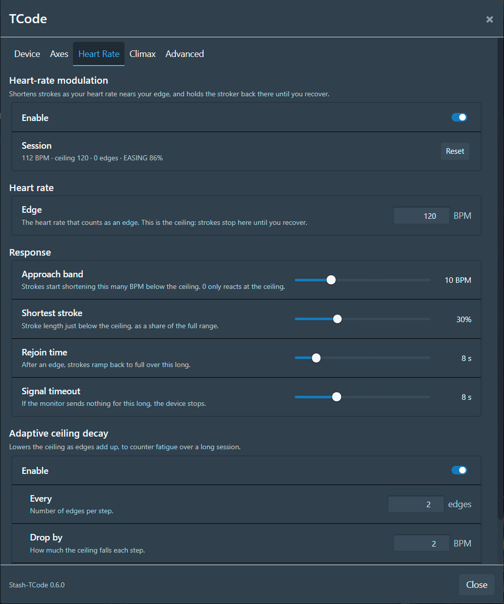
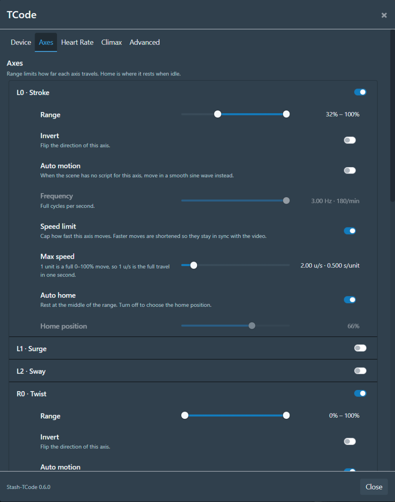
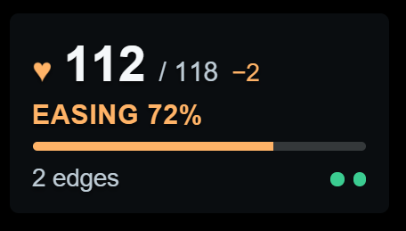

# Stash-TCode

A [Stash](https://github.com/stashapp/stash) plugin that drives TCode devices (OSR2/SR6 and similar)
over USB using the Web Serial API.
It plays a scene's funscripts, including multi-axis ones, on the device in sync with the video.
With a Bluetooth heart-rate monitor it can also shorten strokes as your heart rate climbs and hold
off at the edge.

Maintained by **dtt**. Originally based on Stash-TCode by Spunkle, with modifications by Steel.

## Features

- Connects over USB via Web Serial at 115200 baud, with no websocket bridge, and reconnects
  on its own after a page refresh or when the device is plugged back in.
- Handles single-axis and multi-axis funscripts, plus separate per-axis files
  (`.surge`, `.sway`, `.twist`, `.roll`, `.pitch`).
- Per-axis range, invert and home position, all saved across refreshes.
- Optional per-axis speed limit, as a percentage of full travel per second (300%/s is the same as
  3 u/s in MultiFunPlayer). Moves that would be faster are shortened rather than slowed, so
  playback stays in sync.
- Auto motion: any axis the scene has no script for can follow a smooth sine wave at its own
  frequency, so a video without a funscript still gets motion.
- Idle motion: the stroke axis can keep a slow stroke going whenever no video is playing, while
  you browse for the next scene or with the video paused. Speed (3-60 strokes a minute) and stroke length are adjustable
  (**Axes → L0 → Idle motion**). It starts 2 s after playback stops and gives way the moment a video plays.
- Linked axes: an axis can **follow** another, e.g. twist mirroring stroke: when stroke goes
  0-100%, twist goes 0-100% of its own range, in step. Use the follower's Invert to reverse it.
  It applies when the axis has no script of its own, or always with **Override script** on.
- Settings live in a dialog built from Stash's own components, so it matches Stash and any custom theme.
- Heart-rate modulation, adaptive ceiling decay and climax markers (below).
- A stats overlay on the video: heart rate, ceiling, edges and what the limiter is doing.
- Handles seeking, including on transcoded streams.

## Screenshots

<p>
  
  
</p>

Left, the Heart Rate tab. Right, the Axes tab with twist set to follow stroke.

The stats overlay on the video, two edges in: the ceiling has decayed from 120 to 118 BPM and strokes
are easing off at 72%. The navbar button shows the device status and live heart rate; with heart-rate modulation on, a
second dot beside the first shows whether the monitor is sending readings.

<p>
  
  <br>
  
</p>

## Install

### Before you install

- Use a Chromium-based browser (Chrome, Edge): Web Serial and Web Bluetooth only exist there.
- Reach Stash on a secure origin: `localhost`, or HTTPS. If you reach it by a LAN address over plain
  HTTP, add that origin under `chrome://flags/#unsafely-treat-insecure-origin-as-secure` or serve Stash
  over HTTPS.
- The **Stash Interactive Tools** plugin is optional. Without it, Stash-TCode plays each scene's main
  funscript, single- or multi-axis, which Stash serves itself. You need it only for separate per-axis
  files (`video.twist.funscript`, `video.roll.funscript`, ...), which Stash doesn't serve on its own,
  and for picking between several scripts for one scene.

Stash-TCode is tested on Stash v0.31.

### Installing

1. In Stash, go to **Settings → Plugins → Available Plugins → Add Source** and add
   `https://dtt-git.github.io/stash-tcode/main/index.yml`.
2. Tick **Stash-TCode** under that source and click **Install**. Refresh the page.
3. Click **Connect** in the navbar, then pick your device's serial port.
   After that first time it reconnects by itself.

It works on whatever address you reach Stash at (port, reverse proxy or LAN name). When there's a new
version, it shows under **Settings → Plugins → Installed Plugins → Check for updates**.

### Where settings are saved

By default each browser keeps its own settings. To share them, turn on **Advanced → Save settings to
Stash**: every browser on that Stash then uses the same settings, private windows included, and a change
in one shows up in the others the next time they load. Turning it off in any browser turns it off for all
of them, and each keeps the settings it had.

Which serial device and heart-rate monitor to reconnect to always stays with each browser, as the
browser's permission to use them does. In a private window you pick the device again each time.

To install by hand instead, copy the [`plugins/stash-tcode`](plugins/stash-tcode) folder into your
Stash plugins directory, then **Reload plugins** in Stash and refresh.

### Coming from the Tampermonkey userscript

Stash-TCode used to be a Tampermonkey userscript. Version 0.7.0 is its last release: it keeps working,
but gets no more updates.

1. Let Tampermonkey update the userscript to 0.7.0 (it does this itself; a pop-up says the userscript
   is retired). Don't install the plugin alongside an older userscript: both would drive the device.
2. Install the plugin as above and refresh. The userscript sees the plugin, copies your settings over
   and stops running.
3. Refresh once more to load your settings into the plugin, then delete the userscript from
   Tampermonkey.

Your device and heart-rate monitor stay paired: the browser remembers them for Stash's address, not for
Tampermonkey.

## Heart-rate modulation

Connect a monitor under **Device → Heart rate monitor**. Any monitor with the standard Bluetooth
heart-rate service works: chest straps (Polar, Coospo, Garmin, Wahoo, ...) or a watch broadcasting
its heart rate. Then turn it on under **Heart Rate**.

- **Edge** is the heart rate that counts as an edge, and it's your ceiling. In the **approach band**
  below it (default 10 BPM), strokes shorten linearly down to the **shortest stroke** (default 30%). The stroke shortens from the bottom of its
  range; other axes shrink toward their home position.
- **At the ceiling** the stroker parks at the bottom of its range and sits out the script while the
  video keeps playing. Once your heart rate drops 5 BPM below the ceiling, strokes ramp back in over
  the **rejoin time** (default 8 s).
- **Adaptive ceiling decay** lowers the ceiling 2 BPM every 2 edges, down to a floor (105 BPM by
  default), to counter fatigue over a long session. It never raises the ceiling above what you typed.
- **Signal timeout:** if a connected monitor sends no real reading for 8 s, the device stops. That
  includes a strap that's been taken off but keeps repeating its last BPM: packets flagged "no skin
  contact", or a strap that was timing beats and stopped, don't count as readings. With no monitor
  connected at all, scripts play normally.
- **Session** shows the live state, and **Reset** clears the edge count and decay. The session
  survives a page reload but ends when you close the tab.

Changes to how far each axis may move are eased in rather than applied at once. A monitor reports
about once a second, so in the approach band each new reading would otherwise make every axis jump.
Easing back in is gentle, and backing off at the edge happens within about a second. Losing the
monitor's signal still stops the device immediately.

Chrome only reconnects a Bluetooth monitor after a refresh if
`chrome://flags/#enable-web-bluetooth-new-permissions-backend` is on. Without it, the Device tab
shows a one-click **Reconnect**.

## Climax markers

Add a Stash scene marker tagged **Climax** (the tag name is configurable on the **Climax** tab), or
use **Mark climax here** on that tab while the video is at the right spot. Around a climax marker the
limiter lets go, whatever your heart rate: strokes build back to full over 45 s before the marker,
stay full for 20 s (or for the marker's whole range, if it has an end time), then hand control back
over 15 s. All three times are adjustable.

## Development

The plugin is [`plugins/stash-tcode/stash-tcode.js`](plugins/stash-tcode/stash-tcode.js), loaded by
[`stash-tcode.yml`](plugins/stash-tcode/stash-tcode.yml) next to it. `stash-tcode.user.js` at the repo
root is the retired userscript, kept at 0.7.0 so existing Tampermonkey installs still find it; don't
change it.

To try your changes in a local Stash, copy the plugin into your plugins folder, then **Reload plugins**
in Stash and refresh:

```bash
STASH_PLUGINS_DIR=/path/to/stash/plugins dev/deploy-plugin.sh
```

`STASH_PLUGINS_DIR` can also go in a `.env` file at the repo root. Run it again after each edit.

### Debug tools

Turn on **Advanced → Debug mode** to get:

- **Simulated device:** stands in for the hardware. Commands are recorded but nothing moves.
- **Simulate heart rate:** a steady reading once a second in place of a monitor.
- `window.__tcode` in the page console: `commands()` (axis commands sent, parsed), `tx()`,
  `clearTx()`, `state()`, `hr()`, `hrPackets()` (raw monitor packets), `setHr(bpm)` / `setHr(null)`,
  `governor()`, `resetSession()`
  and `simulateDevice()`.

### Tests

The heart-rate governor's math (approach band, edge hysteresis, decay, rejoin ramp, climax window,
watchdog and axis shaping), the auto-motion sine and the speed limit, plus heart-rate packet decoding and
serial port selection, are covered by plain Node tests. `smoothing.test.js` runs a slow twist through an
edge with a simulated monitor and checks the shaping never jolts it, and `idle.test.js` runs idle motion
on a simulated clock. `version.test.js` checks the manifest loads the script and the version matches in
both places.

```
node tests/governor.test.js
node tests/hr-packets.test.js
node tests/serial.test.js
node tests/linked.test.js
node tests/smoothing.test.js
node tests/idle.test.js
node tests/version.test.js
```

### Releasing

Bump the version in both places, `TCODE_VERSION` near the top of `stash-tcode.js` and `version:` in
`stash-tcode.yml`, then push to `main`. The **Deploy** workflow runs the tests and publishes the plugin
source index to GitHub Pages (`https://dtt-git.github.io/stash-tcode/main/index.yml`), where Stash finds
the update.

## Credits

- **dtt**: current maintainer.
- **Spunkle**: wrote the original Stash-TCode userscript.
- **Steel**: made the modded version this project builds on.
- Heart-rate modulation is inspired by [EdgeLoop](https://github.com/marshallmims/edgeloop) by
  marshallmims (AGPL-3.0) and reimplemented independently here.

Licensed under the [GNU GPL v3](LICENSE), the same as the original.
